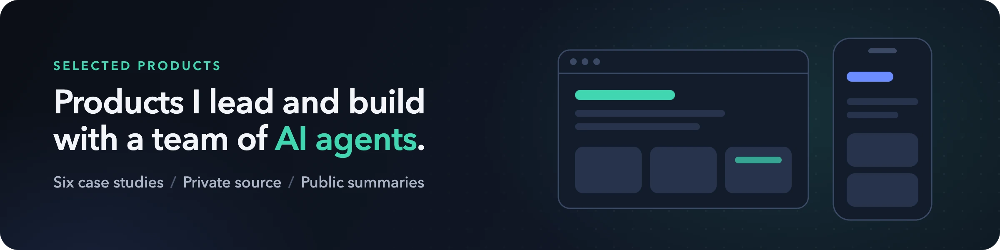
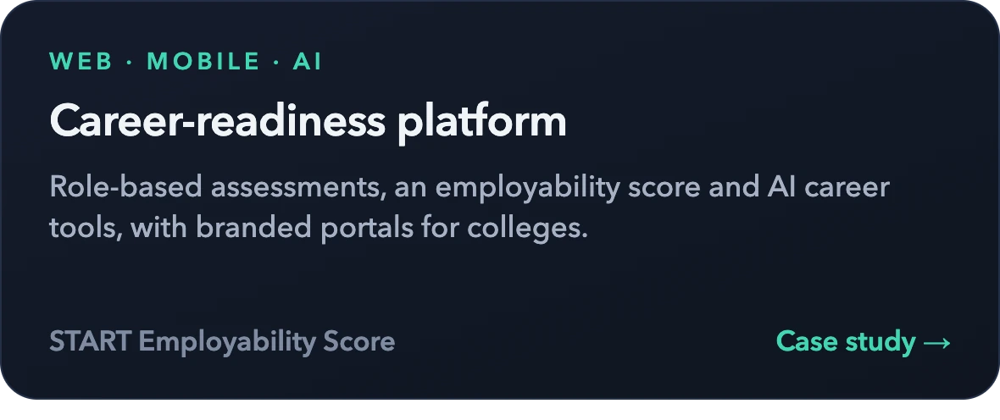
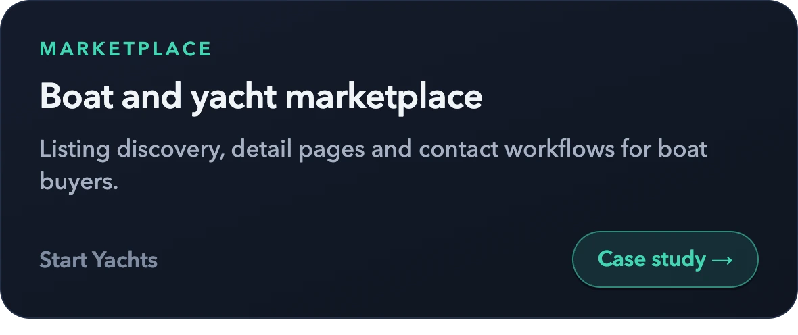
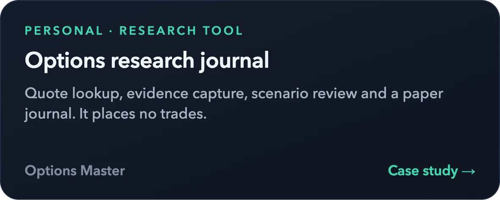
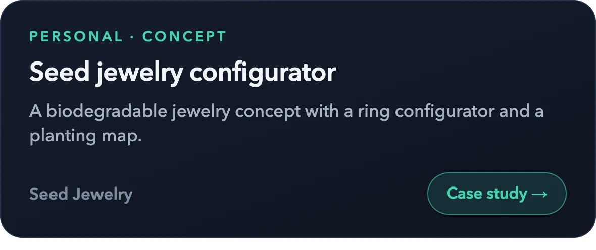

# Selected products

Case studies for products I lead and build with a team of AI agents. The source code is private, so each page shows the product, my role, what it does and how it is built.

How the work gets done is described in [how-i-work](https://github.com/gokselkacar/how-i-work).

## At StartNew Technologies

## My own projects

## Links and stack

| Product | Live | Stack |
| --- | --- | --- |
| [START Employability Score Platform](products/start-employability-score-application.md) | [Product page](https://startnew.ca/platform/assessments-employability-score) | React Native, Expo, Next.js, TypeScript, GraphQL, AWS, PostgreSQL |
| [START Jobs](products/start-jobs-career-readiness-events-platform.md) | [startjobs.ca](https://startjobs.ca/) | PHP, JavaScript, TailwindCSS, MySQL |
| [Start Yachts](products/start-yachts-project.md) | [startyachts.com](https://www.startyachts.com/) | Next.js, TypeScript, AWS, PostgreSQL |
| [START Canada Marketing Site](products/start-canada-marketing-site.md) | [startnew.ca](https://startnew.ca/) | Next.js, React, TypeScript, TailwindCSS |
| [Options Master](products/options-master.md) | Private | Next.js, TypeScript, SQLite, Tesseract.js |
| [Seed Jewelry](products/seed-jewelry.md) | Private | Vite, React, Leaflet |

## About the screenshots

Screens of the Employability Score Platform come from the public product films and show a demo account. Screens of the live sites were taken in November 2026.
