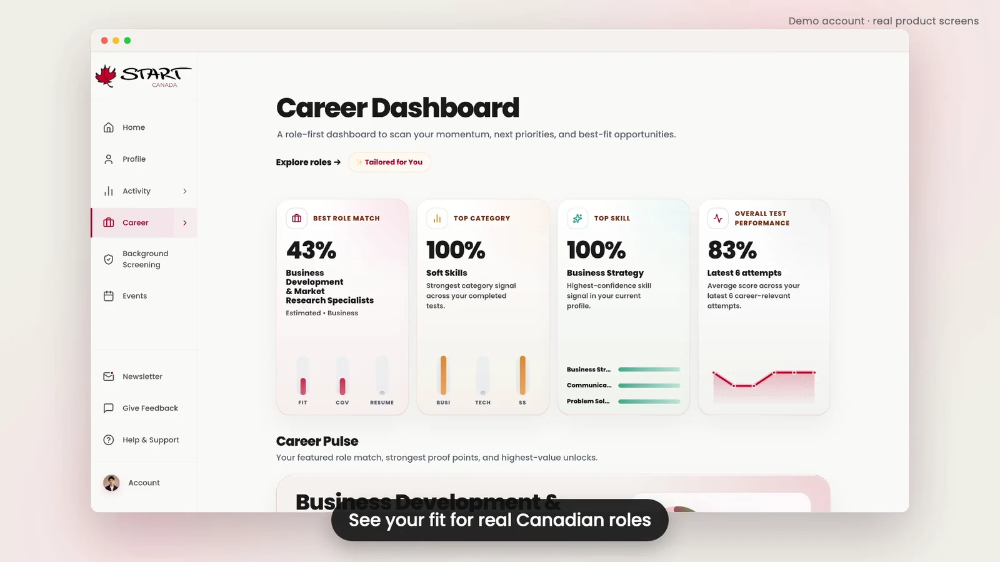

# Selected products

Case studies for products I lead and build with AI coding agents. The source code is private, so each page shows the product, my role, what it does and how it is built.

How the work gets delivered is described in [how-i-work](https://github.com/gokselkacar/how-i-work).

## Products

| Product | What it is | Link | Stack |
| --- | --- | --- | --- |
| [START Employability Score Platform](products/start-employability-score-application.md) | Career-readiness assessments, an Employability Score and AI career tools on web and mobile, with a branded portal for institutions | [Product page](https://startnew.ca/platform/assessments-employability-score) | React Native, Expo, Next.js, TypeScript, GraphQL, AWS, PostgreSQL |
| [START Jobs](products/start-jobs-career-readiness-events-platform.md) | Event discovery and registration for career-readiness bootcamps and workshops | [startjobs.ca](https://startjobs.ca/) | PHP, JavaScript, TailwindCSS, MySQL |
| [Start Yachts](products/start-yachts-project.md) | Boat and yacht marketplace with broker listings and marine services | [startyachts.com](https://www.startyachts.com/) | Next.js, TypeScript, AWS, PostgreSQL |
| [START Canada Marketing Site](products/start-canada-marketing-site.md) | Public site that presents the platform to learners, institutions and employers | [startnew.ca](https://startnew.ca/) | Next.js, React, TypeScript, TailwindCSS |
| [Options Master](products/options-master.md) | Personal options-research and paper-journal tool. No trade execution | Private | Next.js, TypeScript, SQLite, Tesseract.js |
| [Seed Jewelry](products/seed-jewelry.md) | Product concept for biodegradable jewelry with a configurator and planting map | Private | Vite, React, Leaflet |

## About the screenshots

Screens of the Employability Score Platform come from the public product films and show a demo account. Screens of the live sites were taken in November 2026.
