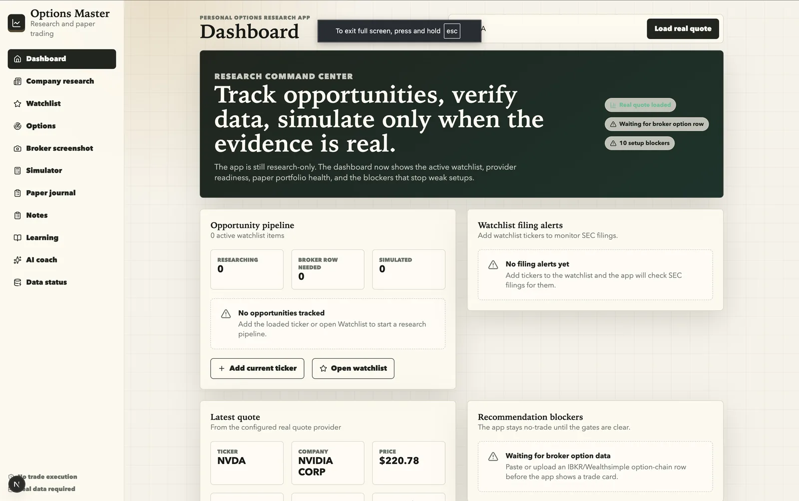
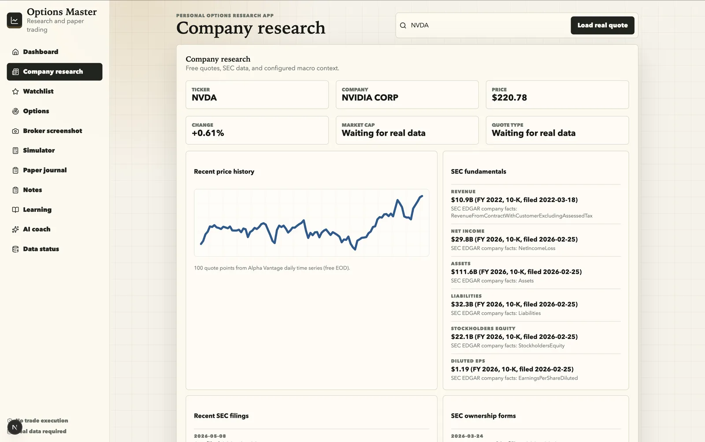
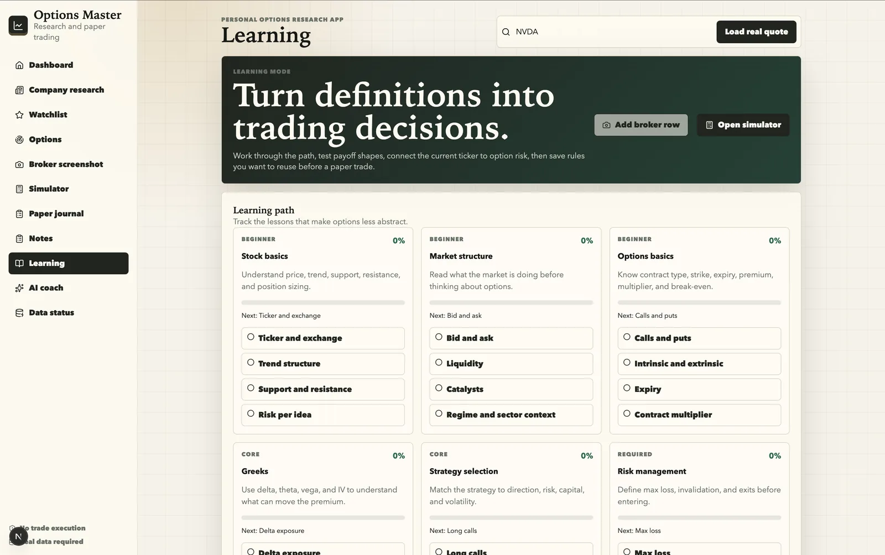
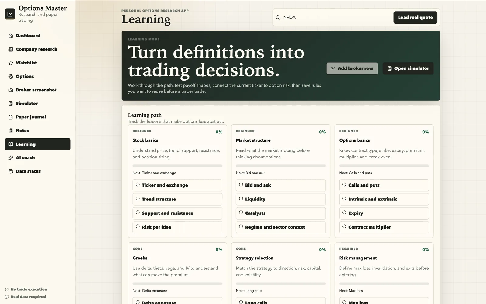
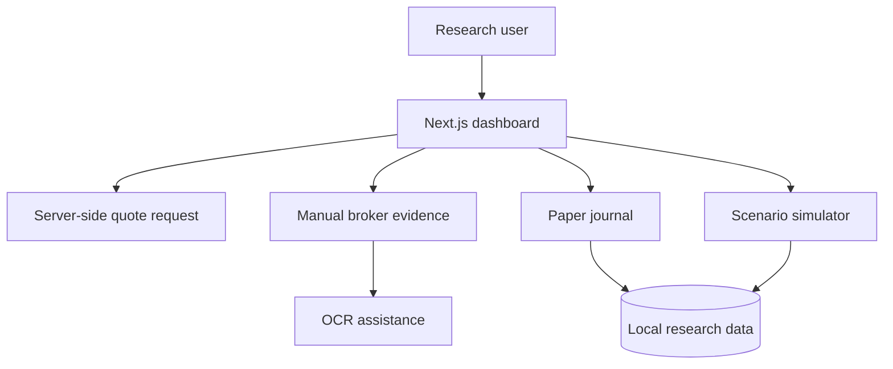

# Options Master

A personal research tool for studying options setups. It gathers quote data and evidence from broker screens, compares scenarios, and keeps a paper-trading journal. It places no trades.

- Personal project
- Source: private repository

## The problem

Learning options from broker screens alone leaves no record of why a setup looked good or what happened next. I wanted one place to capture the evidence, compare outcomes before deciding anything, and review the reasoning later.

## My role

I designed the product and built it with AI coding agents. The main product decision was the boundary: research and paper journaling only, with no trade execution and no generated live recommendations.

## Screens

| Dashboard | Company research |
| --- | --- |
|  |  |

| Learning | AI coach |
| --- | --- |
|  |  |

## What it does

- **Quote lookup.** Real quote data requested through a server-side path, so provider details never reach the browser.
- **Evidence capture.** Broker prices, option rows, Greeks, implied volatility, volume and open interest come from screenshots or manual rows. OCR helps read a screenshot, and the user confirms every value.
- **Scenario review.** Compare assumptions, risk and payoff ranges for a setup.
- **Paper journal.** Record the thesis, the evidence and the follow-up.
- **Honest empty states.** A data provider that is not connected shows as waiting. The app never fills the gap with mock numbers.

## How it is built

Next.js, React and TypeScript, with a local SQLite database, Tesseract.js for OCR and Vitest for tests.

## Repository note

The source code is in a private repository. This page is a public summary.
