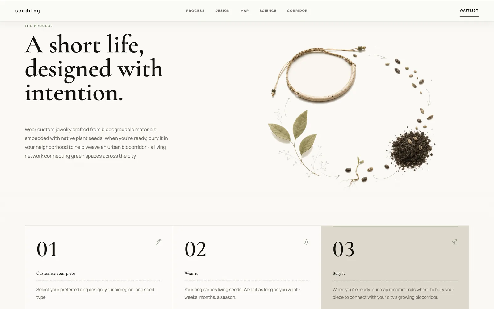
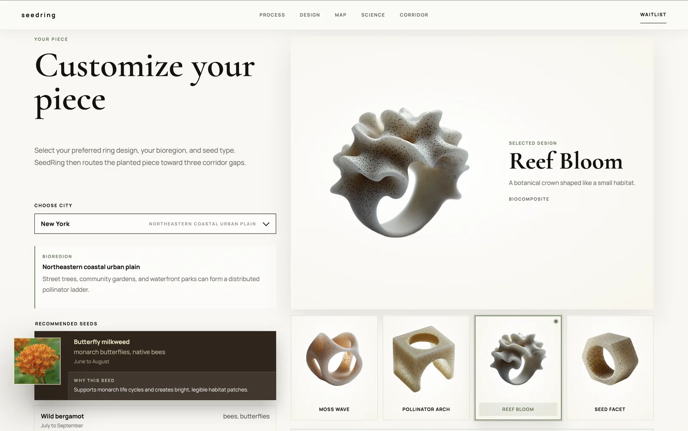
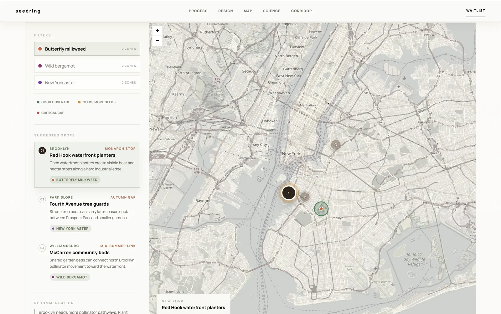
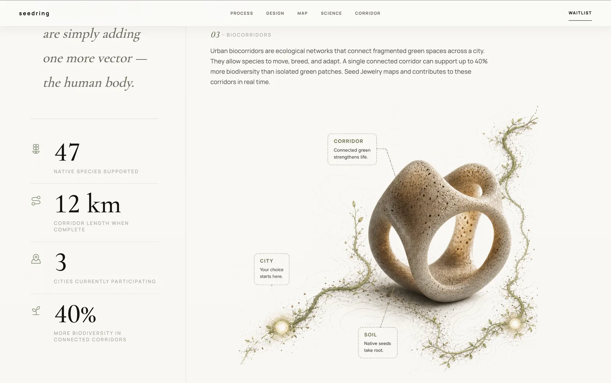
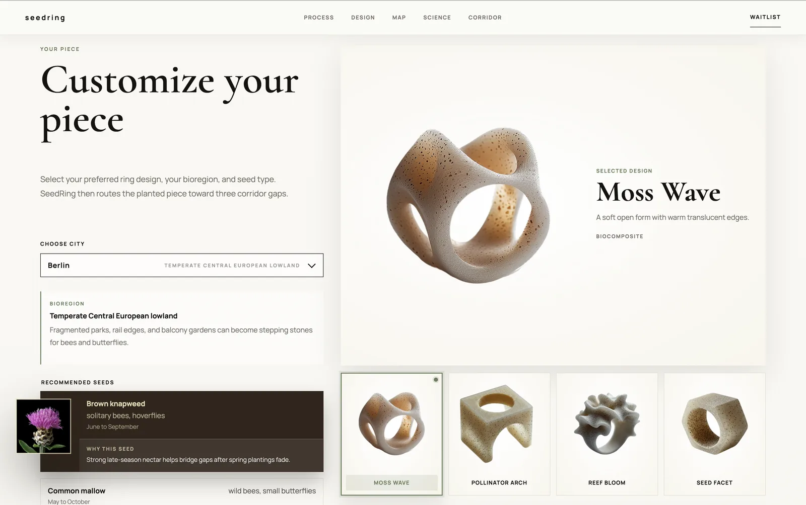
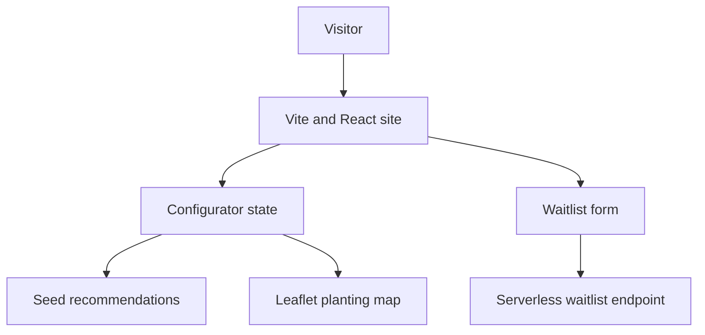

# Seed Jewelry

A product concept called SeedRing: biodegradable jewelry that carries native plant seeds. You wear it, then bury it, and it grows into part of a local pollinator corridor.

- Personal project, concept stage
- Source: private repository

## The problem

The idea only makes sense if a buyer can see which seeds suit their city and where planting them would help. The site had to explain the concept, let someone configure a ring for their region, and show the planting spots on a map.

## My role

I designed the product experience and built it with AI coding agents: the story, the configurator, the planting map and the waitlist.

## Screens

| Hero | Process | Configurator |
| --- | --- | --- |
|  |  |  |

| Planting map | Science section | Second ring design |
| --- | --- | --- |
|  |  |  |

## What it does

- **Configurator.** Pick a city, a seed type and a ring design. The page updates the seed rationale, the flower imagery and the summary as you choose.
- **Planting map.** An interactive map with seed and coverage filters that suggests corridor gaps for the selected seed.
- **Three-step story.** Customize, wear, bury.
- **Waitlist.** A sign-up form that posts to a serverless endpoint, so the site needs no always-on backend.

## How it is built

Vite and React with Leaflet for the map, and Playwright tests for the copy, the responsive layout, the map and the waitlist.

## Repository note

The source code is in a private repository. This page is a public summary.
