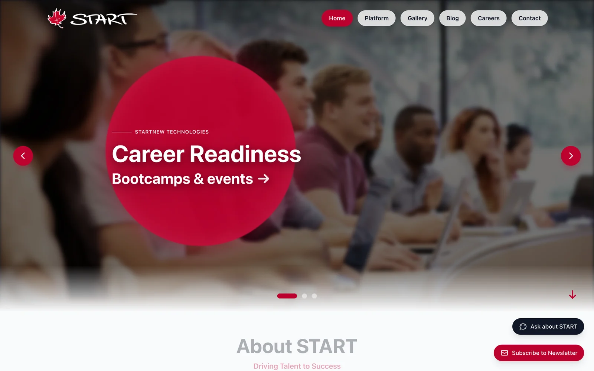
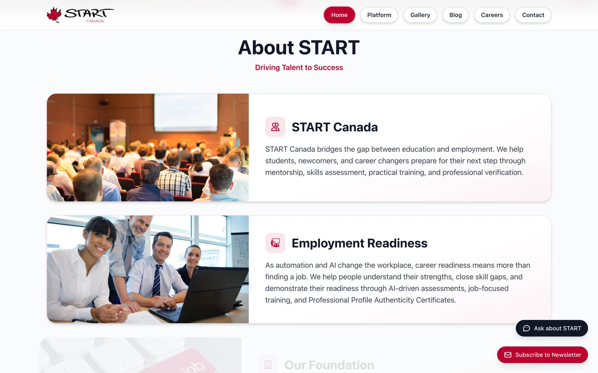
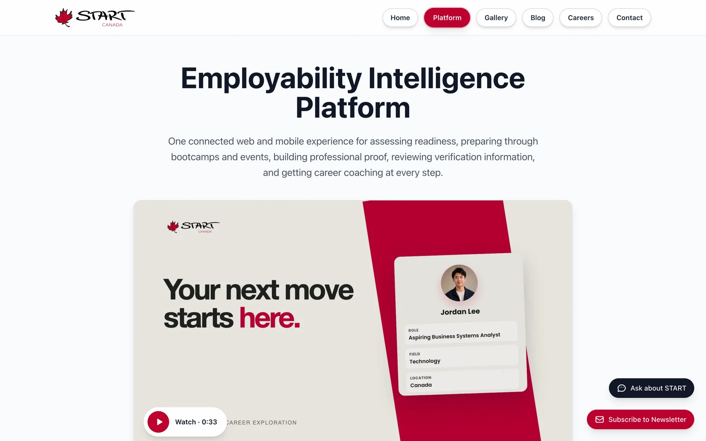
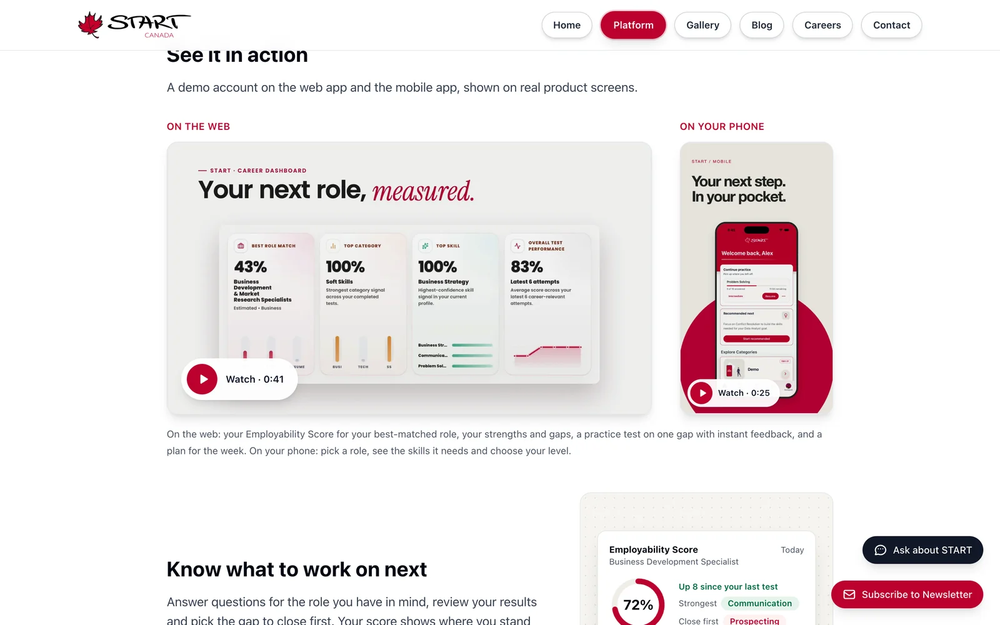
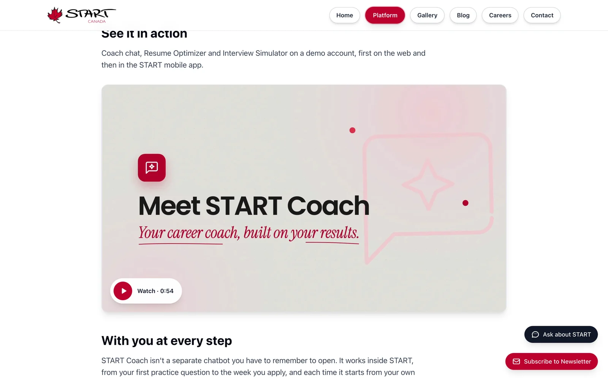
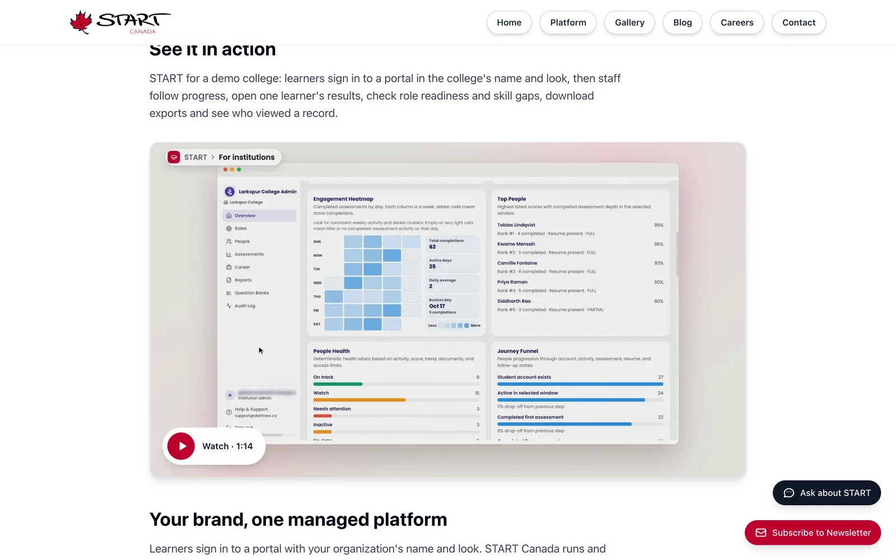
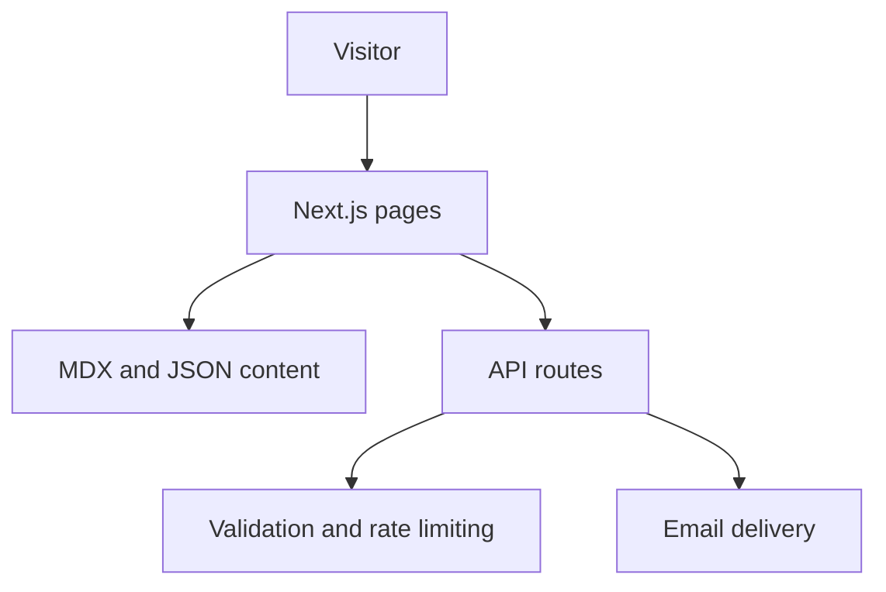

# START Canada Marketing Site

The public website for START Canada. It explains the platform to learners, institutions and employers, shows the product in short films, and routes enquiries to the right place.

- Live site: [startnew.ca](https://startnew.ca/)
- Company: StartNew Technologies
- Source: private repository

## The problem

START sells one platform to several audiences who care about different things. A learner wants to know what the score tells them. A college wants to know what its staff will see. The site gives each audience its own page and shows real product screens on a demo account.

## My role

I lead the site's content structure and product presentation and direct its development with AI coding agents. I also directed the product films shown on the platform pages, which are recorded from the real product. The method is described in [how-i-work](https://github.com/gokselkacar/how-i-work).

## Screens

| Home | About START | Platform overview |
| --- | --- | --- |
|  |  |  |

| Assessments and Employability Score | START Coach | For institutions |
| --- | --- | --- |
|  |  |  |

## What it does

- **Audience pages.** Separate pages for the platform, each product area, institutions, employers and high schools.
- **Product films.** Short films on each product page, recorded on a demo account.
- **Contact routing.** A contact form that sends each enquiry by purpose, plus newsletter and support flows.
- **Content.** A blog and a gallery managed as files in the repository, with no separate content system to run.

## How it is built

Next.js with the App Router, React, TypeScript and TailwindCSS. Forms post to a small API layer with validation and rate limiting. Blog posts are MDX files.

## Repository note

The source code is in a private repository. This page is a public summary.
