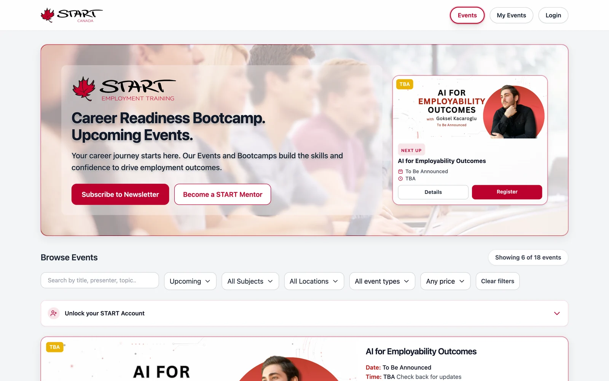
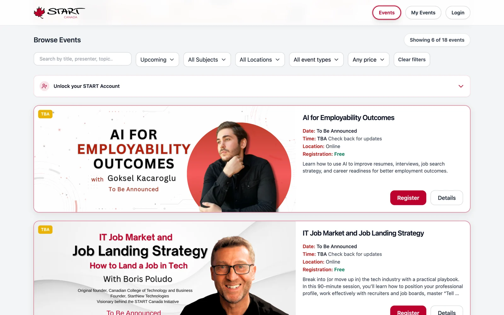
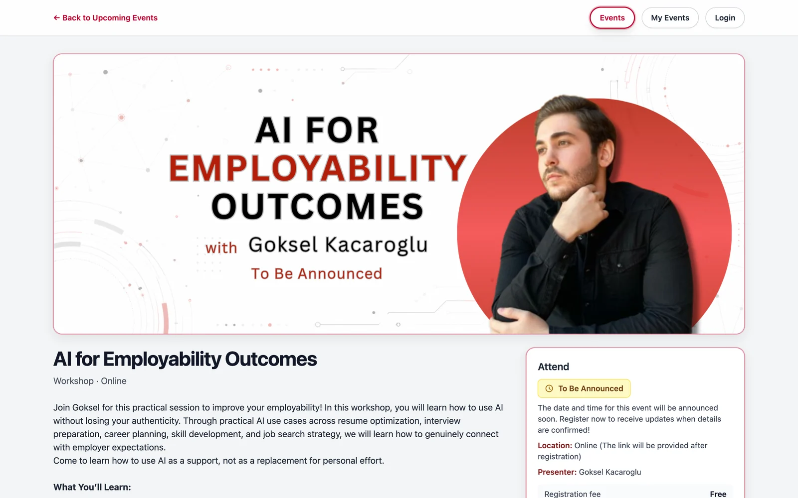
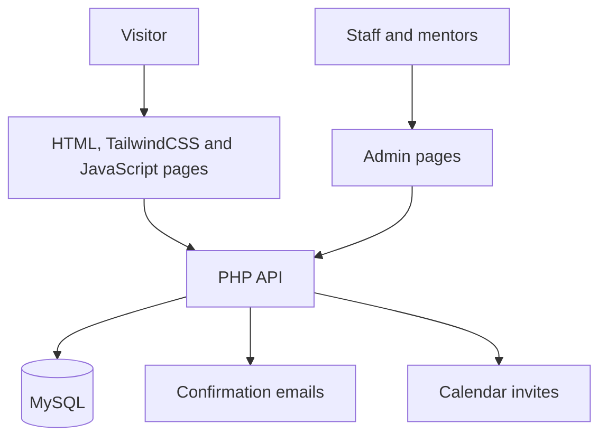

# START Jobs

The events platform for START Canada's career-readiness bootcamps, workshops and webinars. People find an event, register, and manage their registrations. Staff and mentors create and run the events.

- Live site: [startjobs.ca](https://startjobs.ca/)
- Company: StartNew Technologies
- Source: private repository

## The problem

START runs frequent free and paid career events. Registration, reminders, attendance and mentor submissions were too much to handle by hand, and attendees needed one place to see what they had signed up for.

## My role

I lead the product and direct its development and maintenance with AI coding agents: the public event pages, accounts, registration, confirmation emails, and the admin and mentor workflows. I also define how START Jobs connects to the wider START career-readiness experience. The method is described in [how-i-work](https://github.com/gokselkacar/how-i-work).

## Screens

| Events home | Browse and filter | Event detail |
| --- | --- | --- |
|  |  |  |

## What it does

- **Event discovery.** Browse upcoming events and filter by subject, location, type and price.
- **Registration.** Register for a session, get a confirmation email and a calendar invite, and see past and upcoming registrations in one place.
- **Accounts.** Sign-up, email verification, login and password reset.
- **Running events.** Staff draft, review and publish events, see attendees and manage capacity. Mentors can apply and submit sessions.

## How it is built

A PHP backend with a MySQL database, an HTML, TailwindCSS and JavaScript frontend, and email delivery for confirmations.

## Repository note

The source code is in a private repository. This page is a public summary.
