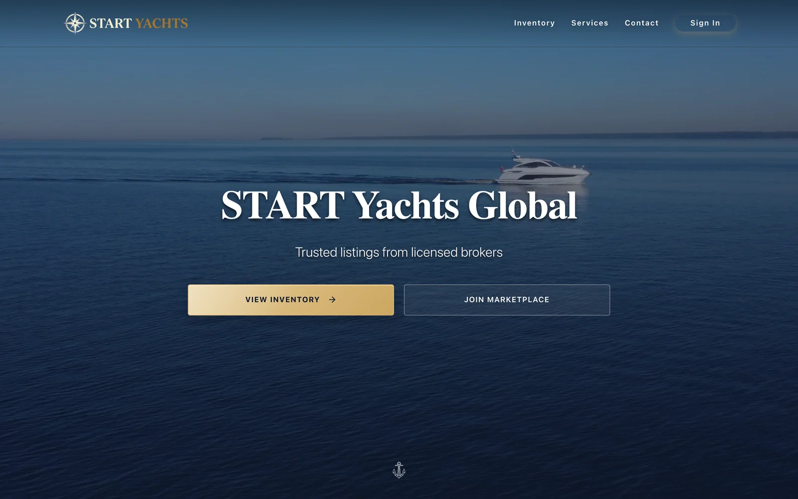
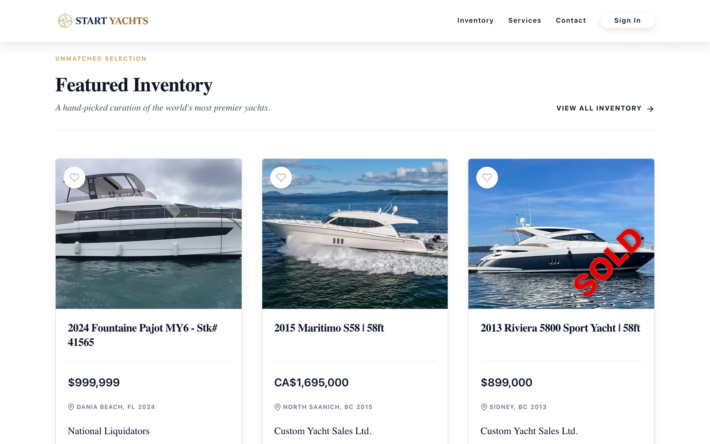
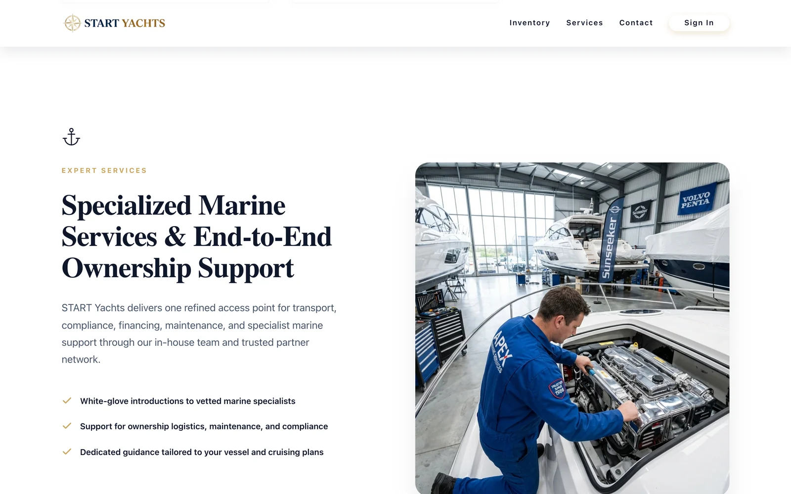
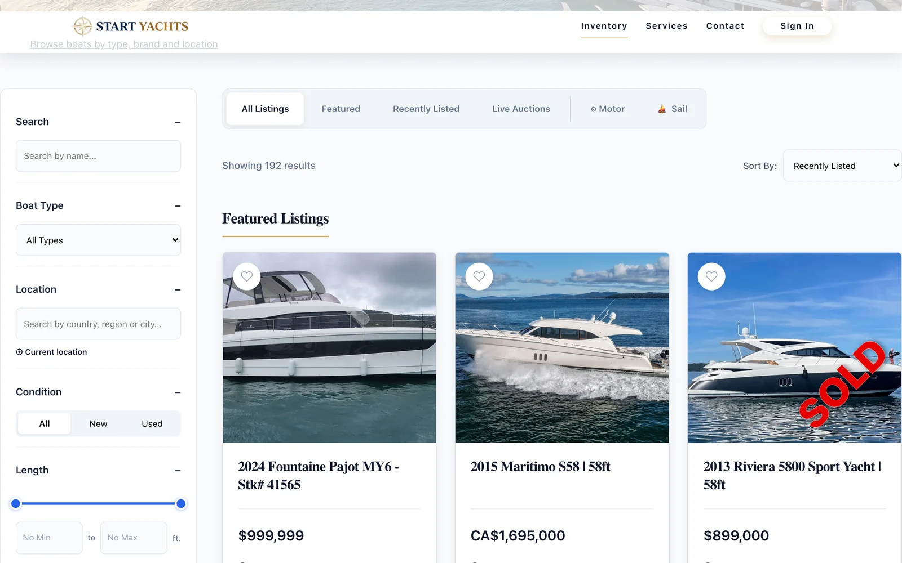
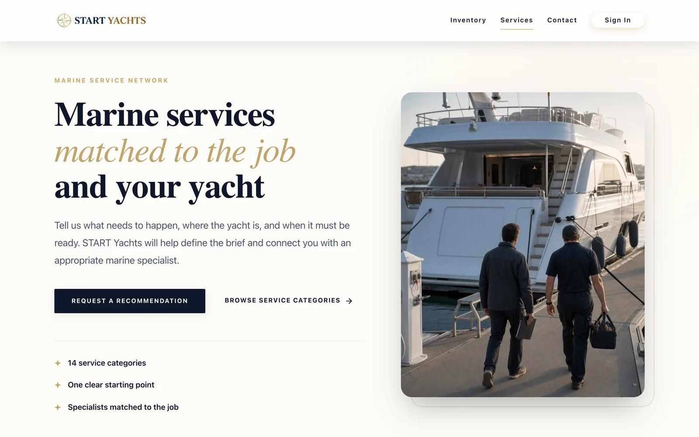
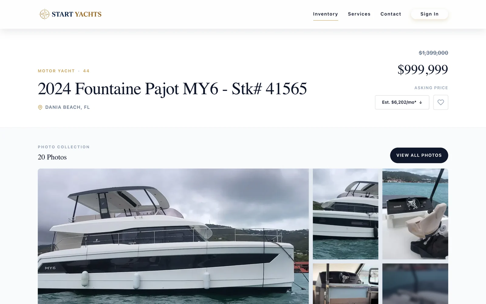
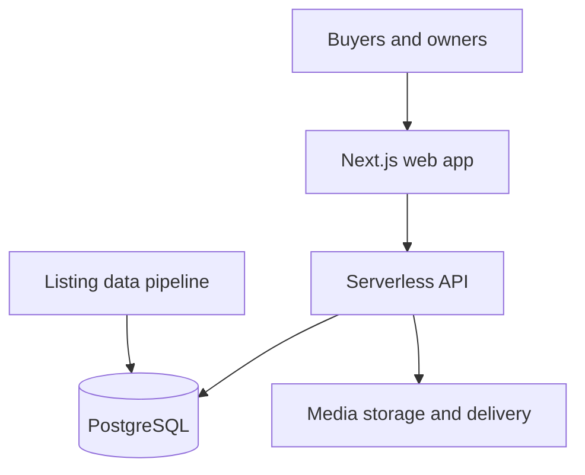

# Start Yachts

A boat and yacht marketplace. Buyers browse listings from licensed brokers, open a listing with its photos and specifications, and contact the broker. Owners find marine services matched to their boat.

- Live site: [startyachts.com](https://www.startyachts.com/)
- Company: StartNew Technologies
- Source: private repository

## The problem

Yacht listings are spread across many broker sites with different layouts and detail. Start Yachts puts them in one searchable catalogue with a consistent listing page, and adds a route to the services an owner needs after buying.

## My role

I lead the product and direct its development with AI coding agents across the web app, the backend services, the listing data pipeline and the cloud infrastructure. It is a separate product from the START career-readiness platform, built with the same delivery method, described in [how-i-work](https://github.com/gokselkacar/how-i-work).

## Screens

| Home | Featured inventory | Services on the home page |
| --- | --- | --- |
|  |  |  |

| Boats for sale | Marine services | Listing detail |
| --- | --- | --- |
|  |  |  |

## What it does

- **Inventory search.** Filter by boat type, location, condition, length and price, with featured and recently listed views.
- **Listing pages.** Photo gallery, overview, description and specifications in one layout for every boat.
- **Broker contact.** A contact form and an offer option on each listing, sent to the listing broker.
- **Marine services.** Service categories and a request form that helps an owner define the job and reach the right specialist.

## How it is built

A Next.js and TypeScript web app, serverless backend services on AWS, PostgreSQL, and media served through a content delivery network. The infrastructure is defined as code.

## Repository note

The source code is in a private repository. This page is a public summary.
